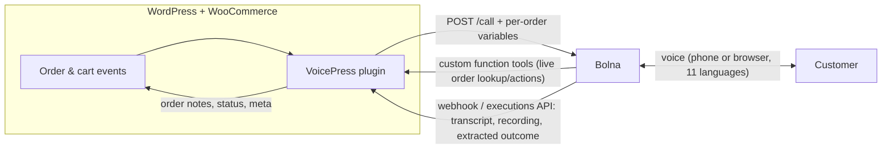

# VoicePress — AI phone agents for every WooCommerce store

**A WordPress plugin that gives any WooCommerce store Bolna voice agents.** They confirm cash-on-delivery orders, handle deliveries and failed deliveries, recover abandoned carts, collect feedback and run a 24×7 order-support line. They work by phone and in the browser, in English and 10 Indian languages. Install the plugin, paste a Bolna API key and click **Create agents**. You don't need Docker, a server or any code.

Built for the [Bolna Symphony Buildathon 2026](https://www.bolna.ai/symphony/buildathon).

---

## Why

| | |
|---|---|
| **WooCommerce is the #1 store platform** | 4.32M live stores, against 3.19M on Shopify ([Store Leads](https://storeleads.app/reports), Oct 2026). It runs 47.4% of sites with a known e-commerce system ([W3Techs](https://w3techs.com/technologies/subdetails/ecommerce)). |
| **…but it has no AI phone agents** | On WordPress.org, no AI phone-call plugin for WooCommerce has more than 10 active installs. On Shopify, 23 of the first 24 results for “ai voice agent” are calling apps. |
| **India: COD is the default, and it comes back** | Only 41% of orders were prepaid in Jan–Nov 2025 ([ClickPost data](https://www.socialsamosa.com/report/prepaid-e-commerce-orders-rise-10958917)). About 26% of COD orders return to origin, against under 2% of prepaid orders ([Shipway, FY25](https://www.mediainfoline.com/techno/click-buy-return-shipway-unveils-why-online-orders-come-back)). |
| **Every return costs money** | ₹150–300 directly on a ₹1,000 order ([ClickPost estimate](https://www.clickpost.ai/blog/rto-reduction-tools)). A Bolna call costs about ₹5.5 a minute ([Inc42](https://inc42.com/features/the-unit-economics-of-indias-voice-ai-boom/)). |
| **India has 1.2 lakh+ WooCommerce stores** | Level with Shopify ([Store Leads](https://storeleads.app/reports/woocommerce/IN/top-stores)). |

Full, fact-checked research with every source: [`docs/research-brief.md`](docs/research-brief.md).

## What it does

| Agent | Trigger (WooCommerce) | What the agent does | Written back to the order |
|---|---|---|---|
| **COD confirmation** | New cash-on-delivery order | Confirms the items, amount and address, and handles cancel, reschedule, address fix or pay-online | Confirmed or cancelled status, notes, COD badge |
| **Delivery and failed delivery (NDR)** | Status changes to *Out for delivery* or *Delivery failed* | Checks the customer is available, reschedules and fixes the address | Delivery preference, notes |
| **Cart recovery** | Checkout abandoned after the shopper typed a phone number | Answers doubts and offers a one-time discount code | Cart marked called, then recovered |
| **Feedback and reviews** | Order *Completed* | Collects a 1–5 rating; a low score becomes an escalation | Rating, note, escalation flag |
| **Support line and “Talk to us” web voice** | Inbound calls to your Bolna number, the voice button on the storefront, callback requests | Answers “where is my order”, returns, cancellations, delivery changes and product questions, using live WooCommerce data | Ticket or order notes |

Also included:
- **Admin:** a dashboard with KPIs (COD confirmed, returns prevented in ₹, carts recovered in ₹, ratings), call logs with recordings, transcripts and extracted outcomes, a *Voice AI* column and bulk actions in the orders list, and a per-order call panel.
- **Languages:** English plus Hindi, Tamil, Telugu, Kannada, Malayalam, Marathi, Bengali, Gujarati, Punjabi and Odia. A call starts in the customer's language: their choice at checkout, or the language of their state. The agent switches if the customer changes language mid-call.

## How it works



### Bolna features used

| Bolna feature | How VoicePress uses it |
|---|---|
| **Agents API v2** | Clicking *Create agents* provisions five agents |
| **Outbound calls with `user_data`** | Each call carries its order context |
| **Custom function tools** | `identify_customer`, `get_order_details`, `confirm_order`, `cancel_order`, `reschedule_delivery`, `update_address`, `request_return`, `record_feedback`, `search_products`, `create_ticket` |
| **Extractions (categories and dispositions)** | Every call becomes a structured outcome that updates the order |
| **Call summaries and recordings** | Shown in the call log |
| **Webhooks and the executions API** | Real-time updates, with polling as a fallback |
| **Inbound number linking** | A support hotline |
| **Web Call SDK** | In-browser voice on the storefront, with short-lived session tokens minted server-side |
| **Multilingual agents** | English plus 10 Indian languages via Sarvam, starting in a chosen language and switching mid-call |

## Quick start (store owner)

1. Upload `plugin/voicepress` to `wp-content/plugins/` and activate it. It needs WooCommerce 8+ and PHP 7.4+.
2. Fill in **VoicePress → Settings**: your Bolna API key, phone number, store persona and languages.
3. Open **VoicePress → Agents** and click **Create all agents**. Optionally, link the Support agent to your number for inbound calls.
4. Turn on the use cases you want under **VoicePress → Automations**.
5. Try it from **Dashboard → Try it live**: enter your phone number and pick a use case.

Bolna must be able to reach your site over HTTPS for live tools and webhooks. Any normal public WordPress host works. On localhost, use a tunnel (see below).

## Local development (no XAMPP, no Docker)

```bash
bash dev/setup.sh                      # portable PHP 8.3 + WordPress + SQLite + WooCommerce (no installs, no admin rights)
cd dev/runtime && ./php/php.exe -S 127.0.0.1:8080 -t wordpress   # http://localhost:8080  (admin / admin)
php downloads/wp-cli.phar --path=wordpress eval-file ../seed/seed-store.php   # demo store "ShopEase"
cloudflared tunnel --url http://127.0.0.1:8080                       # paste the https URL into VoicePress → Settings → Public URL
```

`dev/tunnel-guard.php` is installed as a must-use plugin. Through the tunnel it exposes only VoicePress's token-protected tool and webhook endpoints. wp-admin, the login page, XML-RPC and the storefront stay reachable from localhost only.

## Plain PHP sites

`VoicePress_Bolna_Client` has no WordPress dependencies (it falls back to curl), so non-WordPress PHP shops can use it too. See [`plugin/voicepress/examples/plain-php-order-call.php`](plugin/voicepress/examples/plain-php-order-call.php).

## Security

- **Tool and webhook endpoints:** require a per-site secret, checked with `hash_equals`.
- **Admin routes:** require `manage_woocommerce` and a REST nonce.
- **Public endpoints** (web session, callback, cart capture): rate-limited per IP. Web sessions are minted server-side, so the Bolna key never reaches the browser.
- **Caller verification:** callers are verified by phone match or the last 4 digits before any order details or write actions. Unverified callers get status only.

## Roadmap

1. List on WordPress.org.
2. Run pilots with Indian WooCommerce stores.
3. Add WhatsApp follow-ups through Bolna Workflows, and batch campaigns (COD-to-prepaid, win-back, back-in-stock).
4. Add an owner's daily briefing call.

## License

GPL-2.0-or-later.
